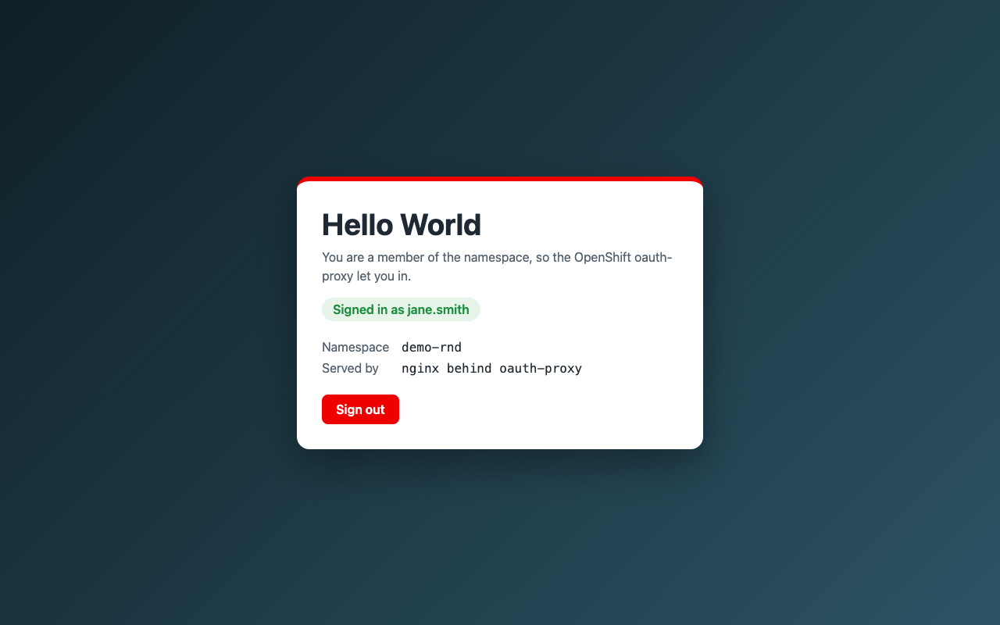

# OpenShift oauth-proxy: limit a page to the users of one namespace

This tutorial is for an engineer who puts an application behind the OpenShift oauth-proxy.
The oauth-proxy is a container in the same pod as the application.
It sends users to the OpenShift login page before they can reach the application.

You will build a small nginx "Hello World" page in the namespace `demo-rnd`.
Only users who are allowed to get the Service of the page in `demo-rnd` can open it.
In practice, these are the members of `demo-rnd` (users with a role in it, here through groups), and users with a cluster-wide role such as `cluster-admin` (5.3).
You can deploy it in two ways: with the YAML files in `manifests/` (this guide), or with the Helm chart in `helm-chart/` (its own README).



## Contents

1. [Requirements](#1-requirements)
2. [What you need](#2-what-you-need)
3. [What is in this repository](#3-what-is-in-this-repository)
4. [How it works](#4-how-it-works)
5. [Why it is built this way](#5-why-it-is-built-this-way)
6. [Step 1: Give access to groups (cluster administrator)](#6-step-1-give-access-to-groups-cluster-administrator)
7. [Step 2: Deploy the page](#7-step-2-deploy-the-page)
8. [Step 3: Check the certificates](#8-step-3-check-the-certificates)
9. [Step 4: Test who can log in](#9-step-4-test-who-can-log-in)
10. [Step 5: Option B, a separate OAuth client](#10-step-5-option-b-a-separate-oauth-client)
11. [Troubleshooting](#11-troubleshooting)
12. [Clean up](#12-clean-up)
13. [Deploy with Helm](#13-deploy-with-helm)
14. [Test results](#14-test-results)
15. [Sources](#15-sources)

## 1. Requirements

The demo must meet these requirements.
Each row says where you check it.

| ID | Requirement | How the demo meets it | Check |
|---|---|---|---|
| R1 | A user must log in with an OpenShift account before the page shows. | The oauth-proxy container is in front of nginx. The Service and the Route send traffic to the proxy only. | 9.1 |
| R2 | Only users who are allowed to get the Service `hello-nginx` in `demo-rnd` can open the page. The built-in role `view` is enough. | The proxy asks the cluster: "can this user get the Service `hello-nginx` in `demo-rnd`?" The roles `view`, `edit` and `admin` in `demo-rnd` allow it. A cluster-wide role that allows it also passes (5.3). | 9.2, 9.3 |
| R3 | A user with `view` and a user with `edit` can both log in. | `jane.smith` has `view`. `john.doe` has `edit`. | 9.3 |
| R4 | Access goes to groups, never to single users. | A cluster administrator binds the groups `demo-rnd-viewers` and `demo-rnd-editors`. No RoleBinding names a user. | 6.3 |
| R5 | The example users are not cluster administrators. | No ClusterRoleBinding names them. `oc auth can-i '*' '*'` says `no`. | 6.4 |
| R6 | Access is given outside the deployment. | The manifests and the Helm chart grant no access. The cluster administrator does step 1 before the deploy. | 6 |
| R7 | A dedicated ServiceAccount is the OAuth client of the proxy. | `hello-oauth-proxy`, in two forms: Option A and Option B. | 7.1, 10 |
| R8 | The two OpenShift CA ConfigMaps are created empty, and OpenShift fills them. | The service CA (an annotation) and the trusted CA bundle (a label). | 8 |
| R9 | The session cookie key is random, and it is never in git. | You make it with `openssl rand`. The Helm chart makes it with a Job. | 7.2 |
| R10 | No one can go around the login. | nginx listens on `127.0.0.1` only. | 8.3 |
| R11 | The containers run with the `restricted-v2` SCC. | No root, a read-only root file system, no Linux capabilities. | 7.3 |

## 2. What you need

1. An OpenShift cluster. This guide uses OpenShift Local (CRC) 4.22.
2. `oc`, logged in as a cluster administrator (on CRC: `kubeadmin`).
3. A pull secret for `registry.redhat.io` in the global pull secret. CRC has one.
4. Users that can log in. The examples use these LDAP users from the identity provider `ldap-local`:

   | User | Use in this guide |
   |---|---|
   | `jane.smith` | A member with the role `view` |
   | `john.doe` | A member with the role `edit` |
   | `alice.cooper` | A user with no access |

   Use your own users if your cluster has other ones.
5. A clone of this repository. Run each command from the repository root.

## 3. What is in this repository

| Path | What it holds |
|---|---|
| `manifests/base/` | The demo (Option A): the OAuth client ServiceAccount, the page, the two CA ConfigMaps, the Service, the Route and the Deployment. |
| `manifests/option-b/` | The changes for Option B: a workload ServiceAccount, a token Secret and a Deployment. |
| `manifests/checks/tls-check-job.yaml` | A Job that checks the proxy certificate with the service CA. |
| `helm-chart/` | The same demo as a Helm chart, with its own README and screenshots. |
| `tests/` | `e2e.sh`, the login tests of step 4 as one script, with its README. |
| `docs/HANDOVER.md` | The state of the work, for the next person. |

## 4. How it works

### 4.1 The objects

| Object | What it sets | Why |
|---|---|---|
| ServiceAccount `hello-oauth-proxy` | The annotation `serviceaccounts.openshift.io/oauth-redirectreference.primary`, which names the Route `hello-nginx` | The annotation makes the ServiceAccount an OAuth client. No OAuthClient object is necessary. |
| ConfigMap `hello-nginx-content` | The page and the nginx configuration | nginx listens on `127.0.0.1:8080`, and it shows the user name that the proxy sends. |
| ConfigMap `hello-nginx-service-ca` | The annotation `service.beta.openshift.io/inject-cabundle: "true"`, no data | The service-ca operator writes the service CA into it. |
| ConfigMap `hello-nginx-trusted-ca` | The label `config.openshift.io/inject-trusted-cabundle: "true"`, no data | The Cluster Network Operator writes the trusted CA bundle into it. |
| Service `hello-nginx` | The annotation `service.beta.openshift.io/serving-cert-secret-name: hello-nginx-tls`, and `targetPort: oauth-proxy` | OpenShift issues the proxy certificate. The Service sends traffic to the proxy, never to nginx. |
| Route `hello-nginx` | `termination: reencrypt` | The router opens a new TLS connection to the proxy, and it trusts the service CA. |
| Deployment `hello-nginx` | An `oauth-proxy` container in front of nginx | The proxy does the login and the access check. |
| Secret `hello-oauth-proxy-cookie` | A random key | The proxy signs the session cookie with it. You make it in step 2. |

These proxy arguments are the important ones:

```text
-provider=openshift
-openshift-service-account=hello-oauth-proxy
-openshift-sar={"namespace":"demo-rnd","resource":"services","resourceName":"hello-nginx","verb":"get"}
-openshift-ca=/var/run/secrets/kubernetes.io/serviceaccount/ca.crt
-openshift-ca=/etc/pki/ca-trust/injected/ca-bundle.crt
-cookie-expire=1h
```

Without `-openshift-sar`, every user who can log in to the cluster can open the page.

### 4.2 The login, step by step

1. The browser opens the Route. The proxy finds no session cookie, and it shows its sign-in page with status 403 (`oauthproxy.go`, `OAuthProxy.Proxy`).
2. The user clicks "Log in with OpenShift". The proxy sends the browser to the OpenShift OAuth server with `client_id=system:serviceaccount:demo-rnd:hello-oauth-proxy`.
3. The user selects an identity provider, and logs in. The first time, the OAuth server asks the user to approve `user:info` and `user:check-access` (`provider.go`, `LoadDefaults`).
4. The OAuth server sends the browser back to `/oauth/callback`. It accepts this URL because the ServiceAccount annotation names the Route.
5. The proxy exchanges the code for a user token at the public OAuth route. Its client secret is the ServiceAccount token. It must trust the CA of the OAuth route.
6. The proxy sends a SubjectAccessReview with the token of the user (`provider.go`, `ReviewUser`). The proxy needs no RBAC for this.
7. If the cluster says no, the user gets "403 Permission Denied" and "Invalid Account" (`oauthproxy.go`, `OAuthCallback`).
8. If the cluster says yes, the proxy sets a signed cookie. It sends each request to nginx with the header `X-Forwarded-User`, and the page shows "Signed in as" that user.

The proxy does the access check only at login (`oauthproxy.go`, `redeemCode`).
A user who loses access keeps the session until the user signs out or the cookie expires.
So keep `-cookie-expire` short if access changes often.

## 5. Why it is built this way

### 5.1 A dedicated ServiceAccount as the OAuth client

`-openshift-service-account=NAME` sets the client ID to `system:serviceaccount:<pod namespace>:NAME`.
It reads the client secret from the token of the pod, at `/var/run/secrets/kubernetes.io/serviceaccount/token` (`provider.go`, `LoadDefaults`).
The proxy reads that file one time, at start.

The OAuth server accepts a client secret in two cases (`oauth-server` `storage.go`, `clientWrapper.ClientSecretMatches`, and `library-go` `oauthclientregistry.go`, `getServiceAccountTokens`):

1. The secret is the token of a Secret of type `kubernetes.io/service-account-token` of that ServiceAccount.
2. The secret is a JWT, and a TokenReview of it gives the user name of that ServiceAccount.

The token of the pod is a JWT of the pod ServiceAccount.
So `-openshift-service-account` and the `serviceAccountName` of the pod must name the same ServiceAccount.
That gives two forms:

| | Option A (step 2) | Option B (step 5) |
|---|---|---|
| The pod runs as | `hello-oauth-proxy`, the OAuth client | `hello-nginx`, a workload ServiceAccount |
| The proxy gets the client secret from | The token of the pod | A token Secret of `hello-oauth-proxy` |
| Use it when | The application does not call the Kubernetes API. nginx does not. | The application calls the Kubernetes API with its own RBAC. |
| Cost | The proxy reads the pod token only at start. On CRC the token was valid for 365 days (`exp` minus `iat`), and each new pod gets a new one. Restart the pod before the token expires, also on a cluster with this one-year token life. | A token that does not expire. Delete the Secret to revoke it. |

A token from `oc create token` also matches case 2.
But it expires, and the proxy reads the file only at start, so do not use it here.

### 5.2 The two CA ConfigMaps

OpenShift fills two kinds of ConfigMap with CA certificates.
You create them empty, and an operator writes the data.

| ConfigMap | How you ask for it | Key | Content | Use |
|---|---|---|---|---|
| `hello-nginx-service-ca` | The annotation `service.beta.openshift.io/inject-cabundle: "true"` | `service-ca.crt` | The service CA. It signs each serving certificate that OpenShift issues. | A client in the cluster checks `https://hello-nginx.demo-rnd.svc` with it. |
| `hello-nginx-trusted-ca` | The label `config.openshift.io/inject-trusted-cabundle: "true"` | `ca-bundle.crt` | The system trust store, and the CAs in `proxy/cluster` `spec.trustedCA`. | An extra `-openshift-ca` for the proxy. The code exchange at the public OAuth route needs it when a company CA signs `*.apps`. |

The first one is an annotation. The second one is a label.
If you use the wrong field, OpenShift writes nothing and shows no error.

`-openshift-ca` can be given more than one time.
When you give it, it replaces the default (`provider.go`, `newOpenShiftClient`).
So the Deployment also names the ServiceAccount `ca.crt`.

### 5.3 The access rule

A member of `demo-rnd` is a user with a RoleBinding in `demo-rnd`, directly or through a group.
The roles `view`, `edit` and `admin` all allow `get` on Services.
So the rule admits a user who can get the Service `hello-nginx` in `demo-rnd`:

```json
{"namespace":"demo-rnd","resource":"services","resourceName":"hello-nginx","verb":"get"}
```

This is the rule that the upstream README shows for `--openshift-sar=JSON`.
A JSON array of rules requires all of them.

A SubjectAccessReview asks "can this user do this?".
Cluster-wide roles also answer it.
So `cluster-admin`, `cluster-reader` and other ClusterRoleBindings that allow `get services` also pass.
No SubjectAccessReview can stop them.
This is the closest rule to "members only" that RBAC can give.

### 5.4 Access through groups

The demo gives access to groups, not to users:

1. You change who has access in one place: the group.
2. Each RoleBinding stays the same when people join or leave.
3. A group can come from LDAP, with `oc adm groups sync`.

The groups in this guide are OpenShift groups that a cluster administrator makes by hand.

## 6. Step 1: Give access to groups (cluster administrator)

Do this step as a cluster administrator, before the deploy.
The team that deploys the page must not decide who can open it, so this step is not in the manifests or in the Helm chart.

### 6.1 Create the project

```bash
oc new-project demo-rnd
```

### 6.2 Create one group per role, and bind each group

```bash
oc adm groups new demo-rnd-viewers jane.smith
oc adm groups new demo-rnd-editors john.doe

oc adm policy add-role-to-group view demo-rnd-viewers -n demo-rnd --rolebinding-name=demo-rnd-viewers-view
oc adm policy add-role-to-group edit demo-rnd-editors -n demo-rnd --rolebinding-name=demo-rnd-editors-edit
```

Expected result:

```text
group.user.openshift.io/demo-rnd-viewers created
group.user.openshift.io/demo-rnd-editors created
clusterrole.rbac.authorization.k8s.io/view added: "demo-rnd-viewers"
clusterrole.rbac.authorization.k8s.io/edit added: "demo-rnd-editors"
```

To add or remove a member later, use `oc adm groups add-users` and `oc adm groups remove-users`.

If you used an earlier version of this tutorial in this namespace, it made the RoleBinding `demo-rnd-members-view`.
`oc apply` does not delete it, so the old group keeps its access. Delete it:

```bash
oc -n demo-rnd delete rolebinding demo-rnd-members-view --ignore-not-found
```

### 6.3 Show that the users are members, through groups only

```bash
oc get groups demo-rnd-viewers demo-rnd-editors
oc -n demo-rnd get rolebindings demo-rnd-viewers-view demo-rnd-editors-edit -o wide
```

Expected result:

```text
NAME               USERS
demo-rnd-viewers   jane.smith
demo-rnd-editors   john.doe

NAME                    ROLE               AGE   USERS   GROUPS             SERVICEACCOUNTS
demo-rnd-viewers-view   ClusterRole/view   16s           demo-rnd-viewers
demo-rnd-editors-edit   ClusterRole/edit   15s           demo-rnd-editors
```

The column `USERS` is empty: no RoleBinding names a user.

### 6.4 Show that the users are not cluster administrators

```bash
oc get clusterrolebindings -o wide | grep -E 'jane\.smith|john\.doe|demo-rnd-viewers|demo-rnd-editors' || echo none
```

Expected result: `none`.

Then log in as each user and ask the cluster.
`oc get user '~'` shows the groups of the user:

```bash
oc login -u jane.smith
oc get user '~' -o jsonpath='{.groups}{"\n"}'
oc auth can-i get service/hello-nginx -n demo-rnd
oc auth can-i create deployment -n demo-rnd
oc auth can-i '*' '*' --all-namespaces
```

Measured results:

| Question | `jane.smith` | `john.doe` | `alice.cooper` |
|---|---|---|---|
| Groups include | `demo-rnd-viewers` | `demo-rnd-editors` | neither |
| `get service/hello-nginx -n demo-rnd` | yes | yes | no |
| `create deployment -n demo-rnd` | no | yes | no |
| `'*' '*' --all-namespaces` (cluster-admin) | no | no | no |
| `get services --all-namespaces` | no | no | no |

On the test cluster, these users are also in LDAP groups with names such as `app-ocp-rbac-alpha-cluster-admin`.
A group name gives no rights. Only a binding does, and `can-i` shows that there is none.

Log in as the cluster administrator again before the next step.

## 7. Step 2: Deploy the page

### 7.1 Create the OAuth client ServiceAccount

This is the ServiceAccount `hello-oauth-proxy`, the OAuth client of the proxy.
It is the file `manifests/base/10-serviceaccount.yaml`, and the Helm chart has the same file in `helm-chart/examples/serviceaccount-oauth-client.yaml`:

```yaml
apiVersion: v1
kind: ServiceAccount
metadata:
  name: hello-oauth-proxy
  namespace: demo-rnd
  annotations:
    serviceaccounts.openshift.io/oauth-redirectreference.primary: '{"kind":"OAuthRedirectReference","apiVersion":"v1","reference":{"kind":"Route","name":"hello-nginx"}}'
```

The annotation makes the ServiceAccount an OAuth client, and it names the Route `hello-nginx`.
Without it, the OAuth server refuses the login.
Give this ServiceAccount no RoleBinding: the proxy does the access check with the token of the user.

Apply it:

```bash
oc apply -f manifests/base/10-serviceaccount.yaml
oc -n demo-rnd get serviceaccount hello-oauth-proxy \
  -o jsonpath='{.metadata.annotations.serviceaccounts\.openshift\.io/oauth-redirectreference\.primary}{"\n"}'
```

Expected result: `serviceaccount/hello-oauth-proxy created`, then the annotation value.
Step 7.3 applies this file again with the other files. That changes nothing.

If a cluster administrator must create ServiceAccounts for your team, the administrator does this step, and you install the Helm chart with `serviceAccounts.oauthClient.create=false` and `cookieSecret.createWithJob=false` (section 8 of the chart README).

### 7.2 Make the cookie key

The proxy signs the session cookie with this key.
Make it on the cluster, and keep it out of git:

```bash
oc -n demo-rnd create secret generic hello-oauth-proxy-cookie \
  --from-literal=session_secret="$(openssl rand -base64 32 | tr -d '\n')"
```

### 7.3 Apply the manifests and wait for the pod

```bash
oc apply -f manifests/base/
oc -n demo-rnd rollout status deployment/hello-nginx --timeout=300s
```

Expected result: `deployment "hello-nginx" successfully rolled out`.
On the first run, the node pulls both images. On CRC, the pulls took 1m54s and 2m4s, one after the other.
When the node had the images, the rollout took 8 seconds.

Check that the pod runs with the restricted SCC:

```bash
oc -n demo-rnd get pods -l app=hello-nginx \
  -o 'custom-columns=NAME:.metadata.name,READY:.status.containerStatuses[*].ready,SCC:.metadata.annotations.openshift\.io/scc'
```

Expected result: `true,true` and `restricted-v2`.

## 8. Step 3: Check the certificates

### 8.1 The proxy certificate and the CA ConfigMaps

```bash
oc -n demo-rnd get secret hello-nginx-tls -o jsonpath='{.type}{"\n"}'
oc -n demo-rnd get configmap hello-nginx-service-ca \
  -o jsonpath='{.data.service-ca\.crt}' | grep -c 'BEGIN CERTIFICATE'
oc -n demo-rnd get configmap hello-nginx-trusted-ca \
  -o jsonpath='{.data.ca-bundle\.crt}' | grep -c 'BEGIN CERTIFICATE'
```

Expected result: `kubernetes.io/tls`, then 1 or more, then a much larger number (147 on CRC).
If a count is 0, the annotation or the label is on the wrong field. Read 5.2.

### 8.2 The certificate chain, from inside the cluster

```bash
oc apply -f manifests/checks/tls-check-job.yaml
oc -n demo-rnd wait --for=condition=complete job/hello-nginx-tls-check --timeout=120s
oc -n demo-rnd logs job/hello-nginx-tls-check
```

Expected result: `OK`, the body of `/oauth/healthz` (`oauthproxy.go`, `PingPage`).

### 8.3 No one can go around the proxy

Call nginx and the proxy on the pod IP, from another pod:

```bash
IP="$(oc -n demo-rnd get pods -l app=hello-nginx -o jsonpath='{.items[0].status.podIP}')"
oc -n demo-rnd run ipcheck --rm -i --restart=Never \
  --image=registry.access.redhat.com/ubi9/nginx-124:1-1795128187 --command -- \
  sh -c "curl -sS -m 5 http://${IP}:8080/; curl -sk -m 5 -o /dev/null -w 'proxy: %{http_code}\n' https://${IP}:8443/"
```

Expected result: `Connection refused` for port 8080, and `proxy: 403` for port 8443.

## 9. Step 4: Test who can log in

The checks in this step are also in one script, `tests/e2e.sh`. Read `tests/README.md`, then run:

```bash
export VIEWER_PASSWORD='...' EDITOR_PASSWORD='...' OUTSIDER_PASSWORD='...'
tests/e2e.sh
```

Expected result: `RESULT: 0 failure(s)`. The steps below do the same checks by hand.

### 9.1 A user who is not logged in

Get the host of the Route, and the CA of the router certificate for `curl`:

```bash
HOST="$(oc -n demo-rnd get route hello-nginx -o jsonpath='{.status.ingress[0].host}')"
oc -n openshift-config-managed get configmap default-ingress-cert \
  -o jsonpath='{.data.ca-bundle\.crt}' > /tmp/ingress-ca.crt
curl -s -o /dev/null -w '%{http_code}\n' --cacert /tmp/ingress-ca.crt "https://${HOST}/"
curl -s -o /dev/null -w '%{http_code} %{redirect_url}\n' --cacert /tmp/ingress-ca.crt "https://${HOST}/oauth/start"
```

Expected result: `403` (the sign-in page).
Then `302` and a URL that contains `client_id=system%3Aserviceaccount%3Ademo-rnd%3Ahello-oauth-proxy`.

### 9.2 A user with no access is refused

Open `https://<HOST>/` in a private browser window.
Click "Log in with OpenShift", select `ldap-local` and log in as `alice.cooper`.
If OpenShift asks, click "Allow selected permissions".

Expected result: "403 Permission Denied" and "Invalid Account".
The proxy log shows the refusal:

```bash
oc -n demo-rnd logs deployment/hello-nginx -c oauth-proxy | grep 'Permission denied for'
```

```text
provider.go:522: Permission denied for alice.cooper@cluster.local for check {"namespace":"demo-rnd","resource":"services","resourceName":"hello-nginx","scopes":[],"verb":"get"}
```

### 9.3 The members are admitted

Open a new private window, and log in as `jane.smith` (role `view`).
Expected result: "Hello World" and "Signed in as jane.smith".
Open `https://<HOST>/whoami`. Expected result: `user=jane.smith`.

Do the same as `john.doe` (role `edit`).
Expected result: "Signed in as john.doe", and `user=john.doe`.

The `helm-chart` README has screenshots of each page.

### 9.4 A removed member keeps the session until it ends

As the cluster administrator, remove `jane.smith` from the group:

```bash
oc adm groups remove-users demo-rnd-viewers jane.smith
```

Reload the page in the window where `jane.smith` is signed in.
Expected result: the page still loads, because the proxy checks access only at login.

Click "Sign out", then log in as `jane.smith` again.
Expected result: "403 Permission Denied".
Without the sign-out, the session ends after `-cookie-expire=1h`.

Add the user again for the next steps:

```bash
oc adm groups add-users demo-rnd-viewers jane.smith
```

## 10. Step 5: Option B, a separate OAuth client

Apply the changes over the base.
They add the workload ServiceAccount `hello-nginx` and the token Secret, and they replace the Deployment:

```bash
oc apply -f manifests/option-b/
oc -n demo-rnd rollout status deployment/hello-nginx --timeout=300s
```

Check that the token controller filled the Secret, and that the pod runs as the workload ServiceAccount:

```bash
oc -n demo-rnd get secret hello-oauth-proxy-token -o jsonpath='{.data.token}' | wc -c
oc -n demo-rnd get pods -l app=hello-nginx -o jsonpath='{.items[0].spec.serviceAccountName}{"\n"}'
```

Expected result: a large number (1700 on CRC), then `hello-nginx`.
Do step 4 again. The results are the same.
The `client_id` in the `/oauth/start` redirect still names `hello-oauth-proxy`.

### 10.1 See why the two names must agree

Edit the Deployment with `oc -n demo-rnd edit deployment hello-nginx`.
Remove `-client-id` and `-client-secret-file`, and add `-openshift-service-account=hello-oauth-proxy`.
The pod still runs as `hello-nginx`, so the client secret is now the token of `hello-nginx`.
The OAuth server refuses the code exchange.

Expected result: "Internal Error" (status 500) after login, and this line in the proxy log:

```text
error redeeming code (client:...): got 400 from "https://oauth-openshift.<apps domain>/oauth/token" {"error":"unauthorized_client","error_description":"The client is not authorized to request a token using this method."}
```

Apply `manifests/option-b/41-deployment.yaml` again to repair it.

## 11. Troubleshooting

| What you see | Cause | What to do |
|---|---|---|
| "Application is not available" (HTTP 503) just after the deploy | The router loads a new Route some seconds after it is created. | Wait some seconds, then load the page again. |
| "Internal Error" after login, and `error redeeming code` with `x509: certificate signed by unknown authority` in the proxy log | The proxy does not trust the CA of the public OAuth route. | Make sure that `hello-nginx-trusted-ca` has data and is mounted, and that `-openshift-ca` names both files. |
| "Internal Error" after login, and `error redeeming code` with `"error":"unauthorized_client"` | The client secret is not a token of the OAuth client ServiceAccount. | Make sure that `serviceAccountName` matches `-openshift-service-account`, or use Option B. |
| "403 Permission Denied" and "Invalid Account" | The cluster said no to the access check. | As that user, run `oc auth can-i get service/hello-nginx -n demo-rnd`. Then check the groups (step 1). |
| The OAuth server refuses the request with `invalid_request` or a redirect error | The annotation names a Route that does not exist, or the Route has no host. | Make sure that the annotation names `hello-nginx`, and that `oc get route hello-nginx` shows a host. |
| The pod stays in `ContainerCreating`, and the events show `FailedMount ... secret "hello-oauth-proxy-cookie" not found` | The cookie Secret does not exist. | Make it (7.2). |
| `ImagePullBackOff` on the proxy | The node cannot pull from `registry.redhat.io`. | Add the registry to the global pull secret, or use a mirror. |
| A user removed from the group still sees the page | The proxy checks access only at login. | The user clicks "Sign out", or waits for `-cookie-expire`. |

## 12. Clean up

As a cluster administrator:

```bash
oc delete project demo-rnd
oc delete group demo-rnd-viewers demo-rnd-editors
```

## 13. Deploy with Helm

The chart in `helm-chart/` installs the same application objects.
Step 1 (groups and access) stays the same, and you still do it outside the chart.
The chart makes the cookie key with a Job, so you do not run `openssl`.
It can also use ServiceAccounts that a cluster administrator made.

Read [helm-chart/README.md](helm-chart/README.md).

## 14. Test results

Measured on CRC (OpenShift 4.22.14, `oc` 4.22.18) on 2026-11-20.
The login tests used `tests/e2e.sh`, and Google Chrome for the screenshots.

| Test | Manifests, Option A | Manifests, Option B | Helm chart |
|---|---|---|---|
| Pod `2/2`, SCC `restricted-v2` | Yes | Yes | Yes |
| Proxy certificate check | `OK` | not run | `OK` (`helm test`) |
| Port 8080 on the pod IP refused | Yes | not run | not run |
| Not logged in: 403, and `/oauth/start` names `hello-oauth-proxy` | Yes | Yes | Yes |
| `alice.cooper` refused | Yes | Yes | Yes |
| `jane.smith` (view) and `john.doe` (edit) admitted | Yes | Yes | Yes |
| Removed member: session kept, refused after sign-out | Yes | Yes | Yes |

Earlier on the same day, with the `developer` user, the mismatch in 10.1 gave the `unauthorized_client` error above.

## 15. Sources

1. `openshift/oauth-proxy` at commit `2c9e613ae807baecb5bbeeb47b567b2e6c47a088`: the README, `main.go`, `options.go`, `oauthproxy.go`, `providers/openshift/provider.go`, `contrib/sidecar.yaml`.
2. `openshift/oauth-server` master: `pkg/oauthserver/auth.go`, `pkg/osinserver/registrystorage/storage.go`.
3. `openshift/library-go` master: `pkg/oauth/oauthserviceaccountclient/oauthclientregistry.go`.
