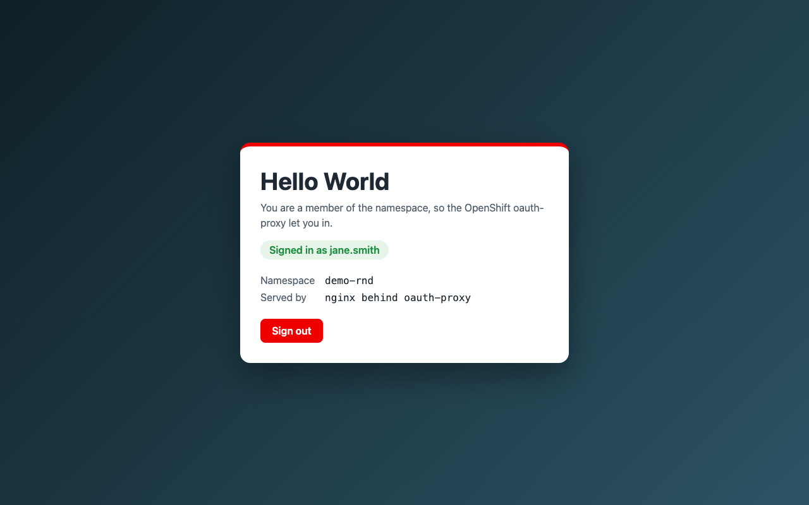
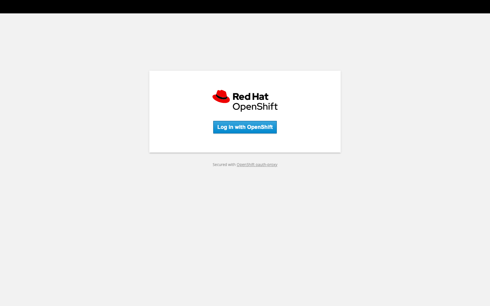
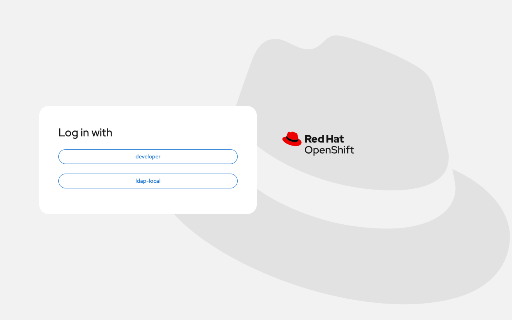
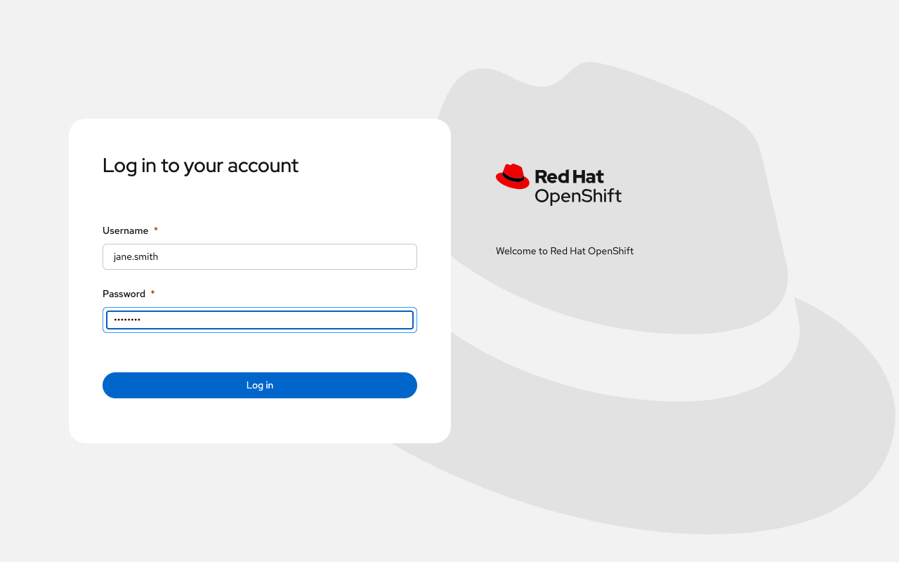
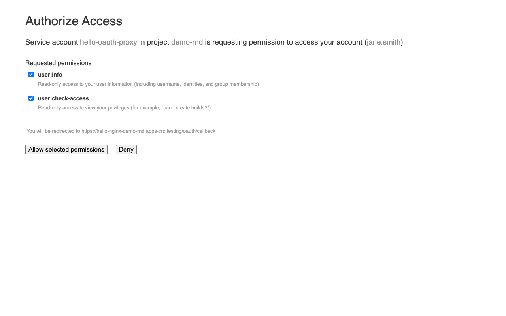
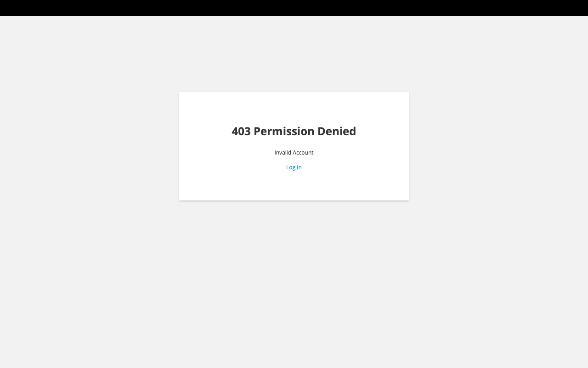

# Helm chart: hello-oauth-proxy

This chart installs an nginx "Hello World" page behind the OpenShift oauth-proxy.
Only users who are allowed to get the Service of the page, in its namespace, can open it.
This is the same demo as the tutorial in the repository root, as one Helm install.



## Contents

1. [Requirements](#1-requirements)
2. [What the chart installs](#2-what-the-chart-installs)
3. [Prerequisites: steps for a cluster administrator](#3-prerequisites-steps-for-a-cluster-administrator)
4. [Install](#4-install)
5. [Test](#5-test)
6. [What the user sees](#6-what-the-user-sees)
7. [Values](#7-values)
8. [Use existing ServiceAccounts](#8-use-existing-serviceaccounts)
9. [The cookie secret](#9-the-cookie-secret)
10. [Upgrade, uninstall and clean up](#10-upgrade-uninstall-and-clean-up)
11. [Troubleshooting](#11-troubleshooting)
12. [Test results](#12-test-results)

## 1. Requirements

| ID | Requirement | How the chart meets it |
|---|---|---|
| R1 | A user must log in with an OpenShift account before the page shows. | An oauth-proxy container is in front of nginx. The Service and the Route send traffic to the proxy only. |
| R2 | Only users who are allowed to get the Service `hello-nginx` in the namespace can open the page. The built-in role `view` is enough. | The proxy asks the cluster: "can this user get the Service `hello-nginx` in this namespace?" The roles `view`, `edit` and `admin` in the namespace allow it. A cluster-wide role that allows it also passes (tutorial, section 5.3). |
| R3 | Access goes to groups, not to single users. | The chart grants no access. A cluster administrator binds groups to roles, before the install (section 3). |
| R4 | A dedicated ServiceAccount is the OAuth client. | The chart creates it, or uses one that a cluster administrator made (section 8). |
| R5 | The session cookie key is random, and it is never in git, in values or in the Helm release. | A Job makes the key on the cluster, one time (section 9). |
| R6 | No one can go around the login. | nginx listens on `127.0.0.1` only. A call to the pod IP on port 8080 is refused. |
| R7 | The containers run with the `restricted-v2` SCC. | No root, a read-only root file system, no Linux capabilities. |

## 2. What the chart installs

| Object | Name (defaults) | What it does |
|---|---|---|
| ServiceAccount | `hello-oauth-proxy` | The OAuth client. Its annotation names the Route. Not created when `serviceAccounts.oauthClient.create=false`. |
| ConfigMap | `hello-nginx-content` | The page and the nginx configuration. |
| ConfigMap | `hello-nginx-service-ca` | Empty. OpenShift writes the service CA into it (annotation). |
| ConfigMap | `hello-nginx-trusted-ca` | Empty. OpenShift writes the trusted CA bundle into it (label). |
| Service | `hello-nginx` | Port 443 to the proxy. OpenShift issues its certificate into the Secret `hello-nginx-tls`. |
| Route | `hello-nginx` | `reencrypt` TLS to the proxy. |
| Deployment | `hello-nginx` | nginx and the oauth-proxy in one pod. |
| Job, with its ServiceAccount, Role and RoleBinding | `hello-oauth-proxy-cookie-job` | A Helm hook. It makes the Secret `hello-oauth-proxy-cookie` if it is missing. Helm deletes the Job and its RBAC when it succeeds. |
| Pod | `hello-nginx-test-tls` | Runs only on `helm test`. It checks the proxy certificate. |

Option B (`serviceAccounts.workload.enabled=true`) adds the workload ServiceAccount `hello-nginx` and the token Secret `hello-oauth-proxy-token`.
Read section 5.1 of the tutorial for when to use Option B.

## 3. Prerequisites: steps for a cluster administrator

These steps are outside the chart, by design.
The team that installs the application must not decide who gets access to it.

You need:

1. `oc` logged in as a cluster administrator, and `helm` 3 or 4.
2. A pull secret for `registry.redhat.io`. The cluster has it in the global pull secret.
3. The users exist in an identity provider. The examples use two LDAP users.

Create the project, then one group per role, then bind each group to its role in the project:

```bash
oc new-project demo-rnd

oc adm groups new demo-rnd-viewers jane.smith
oc adm groups new demo-rnd-editors john.doe

oc adm policy add-role-to-group view demo-rnd-viewers -n demo-rnd --rolebinding-name=demo-rnd-viewers-view
oc adm policy add-role-to-group edit demo-rnd-editors -n demo-rnd --rolebinding-name=demo-rnd-editors-edit
```

The example users and their access:

| User | Group | Role in `demo-rnd` | Can open the page |
|---|---|---|---|
| `jane.smith` | `demo-rnd-viewers` | `view` (the minimum) | Yes |
| `john.doe` | `demo-rnd-editors` | `edit` | Yes |
| `alice.cooper` | none | none | No: "403 Permission Denied" |

Show that the groups have the users, and that the RoleBindings name groups, not users:

```bash
oc get groups demo-rnd-viewers demo-rnd-editors
oc -n demo-rnd get rolebindings demo-rnd-viewers-view demo-rnd-editors-edit -o wide
```

Measured output:

```text
NAME               USERS
demo-rnd-viewers   jane.smith
demo-rnd-editors   john.doe

NAME                    ROLE               AGE   USERS   GROUPS             SERVICEACCOUNTS
demo-rnd-viewers-view   ClusterRole/view   16s           demo-rnd-viewers
demo-rnd-editors-edit   ClusterRole/edit   15s           demo-rnd-editors
```

Show that the users are not cluster administrators.
No ClusterRoleBinding names them or their new groups:

```bash
oc get clusterrolebindings -o wide | grep -E 'jane\.smith|john\.doe|demo-rnd-viewers|demo-rnd-editors' || echo none
```

Expected result: `none`.

Each user can also check their own rights. Log in as the user (`oc login -u jane.smith`), then run:

```bash
oc auth can-i get service/hello-nginx -n demo-rnd      # jane.smith: yes   john.doe: yes
oc auth can-i create deployment -n demo-rnd            # jane.smith: no    john.doe: yes
oc auth can-i '*' '*' --all-namespaces                 # both: no (not cluster-admin)
```

Log in as the cluster administrator (or the user who installs the chart) again, and check it with `oc whoami`.

If you install the chart with existing ServiceAccounts or with your own cookie Secret, do the steps of sections 8 and 9 now too.

## 4. Install

Run from the repository root:

```bash
helm install hello helm-chart -n demo-rnd --wait --timeout 10m
```

Expected result: `STATUS: deployed`.
On CRC, the install took 41 seconds when the images were on the node.
The first pull of all the images can take some minutes.

The install does these things, in this order:

1. Helm creates the Job ServiceAccount, Role and RoleBinding (hook weight -10).
2. The Job makes the Secret `hello-oauth-proxy-cookie`, if it does not exist (hook weight -5).
3. Helm deletes the Job and its RBAC, because they succeeded.
4. Helm creates the other objects, and `--wait` waits for the pod.

## 5. Test

Check the certificate chain from inside the cluster:

```bash
helm test hello -n demo-rnd
oc -n demo-rnd logs hello-nginx-test-tls
```

Expected result: `Phase: Succeeded`, and `OK`.

Get the URL of the page:

```bash
echo "https://$(oc -n demo-rnd get route hello-nginx -o jsonpath='{.status.ingress[0].host}')/"
```

Open the URL in a private browser window, and log in as each example user:

| Log in as | Expected result |
|---|---|
| `jane.smith` (view) | "Hello World" and "Signed in as jane.smith" |
| `john.doe` (edit) | "Hello World" and "Signed in as john.doe" |
| `alice.cooper` (no group) | "403 Permission Denied" and "Invalid Account" |

The first time that a user logs in, OpenShift can ask the user to approve the permissions `user:info` and `user:check-access`.
Click "Allow selected permissions".

For a script, `/whoami` prints the user name as plain text, for example `user=jane.smith`.

To run all the login checks in one step, use `tests/e2e.sh` from the repository root (read `tests/README.md`).

## 6. What the user sees

1. The sign-in page of the proxy. Click "Log in with OpenShift".

   

2. The OpenShift login page. If the cluster has more than one identity provider, select one. The example users are in `ldap-local`.

   

3. Type the user name and the password.

   

4. The first time that a user logs in, OpenShift asks the user to approve two permissions for the proxy:
   `user:info` (read the user name and groups) and `user:check-access` (ask "can I do this?").
   Click "Allow selected permissions". OpenShift keeps this approval, so it asks only one time.
   If the user clicks "Deny", the proxy cannot log the user in.

   

5. A member sees the page with their user name.

   

6. A user who is not a member sees "403 Permission Denied".

   

7. A member clicks "Sign out". The proxy deletes its session cookie, and shows its sign-in page again.
   A request after the sign-out, for example to `/whoami`, gets 403 until the user logs in again.
   To come back, the user clicks "Log in with OpenShift", selects the identity provider and types the password again (measured in Chrome on CRC).

   

The screenshots are from CRC (OpenShift 4.22.14) with Google Chrome, on 2026-11-20.
To show the approval page again for a user, delete the stored approval:
`oc delete oauthclientauthorization <user>:system:serviceaccount:demo-rnd:hello-oauth-proxy`.

## 7. Values

| Value | Default | What it changes |
|---|---|---|
| `name` | `hello-nginx` | The name of the Deployment, Service, Route and ConfigMaps. |
| `images.nginx` | `registry.access.redhat.com/ubi9/nginx-124:1-1795128187` | The web server image. The `helm test` pod uses it too. |
| `images.oauthProxy` | `registry.redhat.io/openshift4/ose-oauth-proxy-rhel9:v4.15` | The proxy image. |
| `images.cli` | `registry.redhat.io/openshift4/ose-cli-rhel9:v4.22` | The `oc` image of the cookie Job. Use your cluster minor version. |
| `serviceAccounts.oauthClient.create` | `true` | `false`: use an existing OAuth client ServiceAccount (section 8). |
| `serviceAccounts.oauthClient.name` | `hello-oauth-proxy` | The name of the OAuth client ServiceAccount. |
| `serviceAccounts.workload.enabled` | `false` | `true`: Option B. The pod runs as a separate workload ServiceAccount. |
| `serviceAccounts.workload.create` | `true` | `false`: use an existing workload ServiceAccount (section 8). |
| `serviceAccounts.workload.name` | `hello-nginx` | The name of the workload ServiceAccount. |
| `cookieSecret.createWithJob` | `true` | `false`: no Job. A cluster administrator makes the Secret (section 9). |
| `oauthProxy.cookieExpire` | `1h` | How long a session lasts. |
| `route.host` | `""` | The host of the Route. Empty lets the router choose. |
| `page.title` | `Hello World` | The heading of the page. |

## 8. Use existing ServiceAccounts

Some teams cannot create ServiceAccounts.
Then a cluster administrator creates them, and the chart only names them.

1. The cluster administrator edits and applies the example `examples/serviceaccount-oauth-client.yaml`.
   Make sure that the namespace is correct, and that the annotation names the Route (the value `name`):

   ```yaml
   apiVersion: v1
   kind: ServiceAccount
   metadata:
     name: hello-oauth-proxy
     namespace: demo-rnd
     annotations:
       serviceaccounts.openshift.io/oauth-redirectreference.primary: '{"kind":"OAuthRedirectReference","apiVersion":"v1","reference":{"kind":"Route","name":"hello-nginx"}}'
   ```

   ```bash
   oc apply -f helm-chart/examples/serviceaccount-oauth-client.yaml
   ```

   Expected result: `serviceaccount/hello-oauth-proxy created`.

2. For Option B, also the workload ServiceAccount:

   ```bash
   oc apply -f helm-chart/examples/serviceaccount-workload.yaml
   ```

3. The cookie Job also brings a ServiceAccount, a Role and a RoleBinding.
   If your team cannot create them, the cluster administrator also makes the cookie Secret (section 9):

   ```bash
   oc -n demo-rnd create secret generic hello-oauth-proxy-cookie \
     --from-literal=session_secret="$(openssl rand -base64 32 | tr -d '\n')"
   ```

4. Install with `create=false` and `createWithJob=false`.
   The chart then renders no ServiceAccount, no Role and no RoleBinding:

   ```bash
   helm install hello helm-chart -n demo-rnd --wait --timeout 10m \
     --set serviceAccounts.oauthClient.create=false \
     --set serviceAccounts.oauthClient.name=hello-oauth-proxy \
     --set cookieSecret.createWithJob=false
   ```

   For Option B, add:

   ```bash
     --set serviceAccounts.workload.enabled=true \
     --set serviceAccounts.workload.create=false \
     --set serviceAccounts.workload.name=hello-nginx
   ```

Check that the release has no ServiceAccount and no Role, in its objects and in its hooks:

```bash
helm get manifest hello -n demo-rnd | grep -cE 'kind: (ServiceAccount|Role|RoleBinding)$'
helm get hooks hello -n demo-rnd | grep -cE 'kind: (ServiceAccount|Role|RoleBinding)$'
```

Expected result: `0` and `0`.

Use `create=false` for a new install.
Do not change `create` from `true` to `false` on a release that is installed: Helm then deletes the ServiceAccount that it made, and the pod still uses it.
To move an installed release to an existing ServiceAccount, the administrator first makes a ServiceAccount with another name, then you upgrade with the new name and `create=false` together.
A new name for the OAuth client also gives a new name to the cookie Secret (`<name>-cookie`).
With `createWithJob=false`, the administrator must create `<new name>-cookie` (section 9) before the upgrade, or the new pod cannot start.

## 9. The cookie secret

The proxy signs the session cookie with a random key.
Without Helm, you make the key with this command:

```bash
oc -n demo-rnd create secret generic hello-oauth-proxy-cookie \
  --from-literal=session_secret="$(openssl rand -base64 32 | tr -d '\n')"
```

The chart does the same with a Job (`templates/cookie-secret-job.yaml`).
The Job runs before each install and each upgrade:

1. If the Secret exists, the Job keeps it and stops. The log says `Secret hello-oauth-proxy-cookie exists. It is kept.`
2. If the Secret does not exist, the Job makes 32 random bytes in base64 and creates the Secret.

Why a Job, and not a template:

1. A Secret template with `randAlphaNum` makes a new key at each upgrade. Each user is then signed out.
2. The `lookup` function can keep the old key under `helm install`, but it returns nothing under `helm template`. Argo CD and other tools use `helm template`, so they would make a new key at each sync.
3. With the Job, the key is never in the chart, in the values or in the Helm release.

If the team cannot run the Job, set `cookieSecret.createWithJob=false`.
Then a cluster administrator runs the `oc create secret` command above before the install.
The chart then creates no Job, no ServiceAccount, no Role and no RoleBinding for it.

To change the key:

1. Delete the Secret: `oc -n demo-rnd delete secret hello-oauth-proxy-cookie`.
2. Make a new one: run `helm upgrade hello helm-chart -n demo-rnd --reuse-values` (Job mode), or run the `oc create secret` command above (`createWithJob=false`).
3. Restart the pod, and wait until the old pod is gone:

   ```bash
   oc -n demo-rnd rollout restart deployment/hello-nginx
   oc -n demo-rnd rollout status deployment/hello-nginx --timeout=10m
   oc -n demo-rnd get pods -l app=hello-nginx
   ```

The proxy reads the key only when it starts.
The old key stays in use until no old pod is left: on CRC, an old session still got 200 after steps 1 and 2, and 403 after step 3.
The change is complete when `get pods` shows only the new pod. Then each user must log in again.

## 10. Upgrade, uninstall and clean up

Upgrade, for example with a new title.
When you give new values (for example `--set page.title=...`), also give `--reuse-values` or the full values file of the install.
Without it, Helm uses the defaults for each value that you do not give again, for example `create=true`:

```bash
helm upgrade hello helm-chart -n demo-rnd --reuse-values --set page.title="Hello OpenShift" --wait --timeout 10m
```

A change to the page restarts the pod, because of the `checksum/content` annotation.
A new chart version also restarts it.
The cookie key stays the same, so the users stay signed in.

Uninstall:

```bash
helm uninstall hello -n demo-rnd
```

Helm keeps these objects, because the release did not create them:

1. The Secret `hello-oauth-proxy-cookie` (made by the Job).
2. The pod `hello-nginx-test-tls` (made by `helm test`).
3. The ServiceAccounts, groups and RoleBindings that a cluster administrator made.

To remove everything, as a cluster administrator:

```bash
oc delete project demo-rnd
oc delete group demo-rnd-viewers demo-rnd-editors
```

## 11. Troubleshooting

| What you see | Cause | What to do |
|---|---|---|
| "Application is not available" (HTTP 503) just after the install | The router loads a new Route some seconds after Helm creates it. | Wait some seconds, then load the page again. |
| `helm install` stops at the hook, or the Job fails | The node cannot pull `images.cli`, or the Job cannot create the Secret. | Run `oc -n demo-rnd get events`. Set `images.cli` to a tag that the cluster can pull, or use `cookieSecret.createWithJob=false`. |
| No pod. `oc -n demo-rnd get events` shows `FailedCreate ... error looking up service account demo-rnd/hello-oauth-proxy: serviceaccount "hello-oauth-proxy" not found` | `create=false`, but no one created the ServiceAccount. | Apply the file from `examples/` (section 8). |
| The pod stays in `ContainerCreating`, and the events show `FailedMount ... secret "hello-oauth-proxy-cookie" not found` | The Secret `hello-oauth-proxy-cookie` does not exist. | Make it (section 9), or install with `cookieSecret.createWithJob=true`. |
| "403 Permission Denied" and "Invalid Account" for a member | The user is not in a group with a role in the namespace. | As the user, run `oc auth can-i get service/hello-nginx -n demo-rnd`. Then read section 3. |
| The OAuth server refuses the login with a redirect error | The annotation of the OAuth client ServiceAccount names another Route. | Make the annotation name the value `name` (default `hello-nginx`). |
| "Internal Error" after login | The client secret is not a token of the OAuth client ServiceAccount, or the proxy does not trust the OAuth route. | Read the proxy log: `oc -n demo-rnd logs deployment/hello-nginx -c oauth-proxy`. Then read section 11 (troubleshooting) of the tutorial. |
| A user removed from the group still sees the page | The access check runs only at login. | The user signs out with the button, or the session ends after `oauthProxy.cookieExpire`. |

## 12. Test results

Measured on CRC, OpenShift 4.22.14, with Helm 4.3.1, on 2026-11-20.
The login tests used LDAP users and `tests/e2e.sh`, which posts the real login forms.

| Test | Result |
|---|---|
| `helm lint` | 0 charts failed. |
| The chart renders the same application objects as `manifests/` | The same for Option A and Option B. The differences: the Helm labels, the `checksum/content` annotation, and the objects that only the chart has (the cookie Job with its RBAC, and the `helm test` pod). |
| `helm install`, then `helm test` | `deployed`, then `Succeeded` and `OK`. |
| 14 login checks (anonymous, `alice.cooper` refused, `jane.smith` and `john.doe` admitted, a removed member, sign-out) | 14 passed, for each of the four installs in this table. |
| `helm upgrade` with a new title | A new pod and the same key. An old session of `jane.smith` still got 200, with the new title. The CA ConfigMaps kept their data (1 and 147 certificates). |
| The cookie Job on upgrade | It logged `exists. It is kept.`, and the Job and its RBAC were deleted after it succeeded. |
| Option B (`serviceAccounts.workload.enabled=true`) | The pod ran as `hello-nginx`. The token had 1700 characters. |
| Existing ServiceAccounts and an administrator-made cookie Secret | The release had no ServiceAccount, Job or Role. 14 checks passed, also for Option B. |
